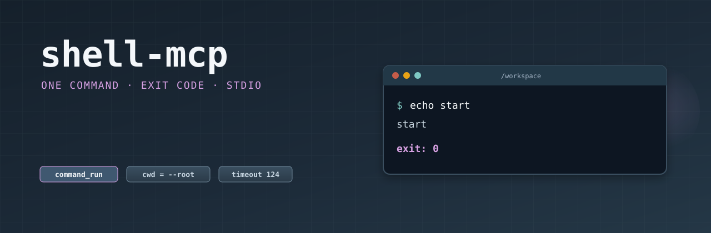

# shell-mcp

<p align="center">
  
</p>

<p align="center">
  <a href="https://github.com/shotah/shell-mcp/actions/workflows/ci.yml"></a>
  <a href="https://github.com/shotah/shell-mcp/actions/workflows/release.yml"></a>
  <a href="https://github.com/shotah/shell-mcp/actions/workflows/ci.yml"></a>
  <a href="https://pkg.go.dev/github.com/shotah/shell-mcp"></a>
  
  <a href="LICENSE"></a>
</p>

One shell command over MCP stdio. Server id `shell`. The host calls `shell__command_run`.

The working directory starts at `--root`. The container, or that directory on a host unit, is the sandbox. Tests and builds are arguments to `command_run`, not extra tools.

Naming: [george docs/mcp-naming.md](https://github.com/shotah/george/blob/main/docs/mcp-naming.md).

## Run

```bash
go install github.com/shotah/shell-mcp@latest
shell-mcp --root /workspace
```

```toml
[[server]]
name    = "shell"
command = "shell-mcp"
args    = ["--root", "/workspace"]
force   = true
```

## Development

```bash
make lint
make test
make coverage   # fails below 70%
make release    # patch bump; BUMP=minor|major or TAG=v0.2.0
```

CI (`.github/workflows/ci.yml`) runs the same lint, tests, and `scripts/check-coverage.sh` at 70%. `make check` is the local equivalent. `make release` writes `VERSION`, tags `v*` and floating `latest`, and pushes so the Release workflow runs.
